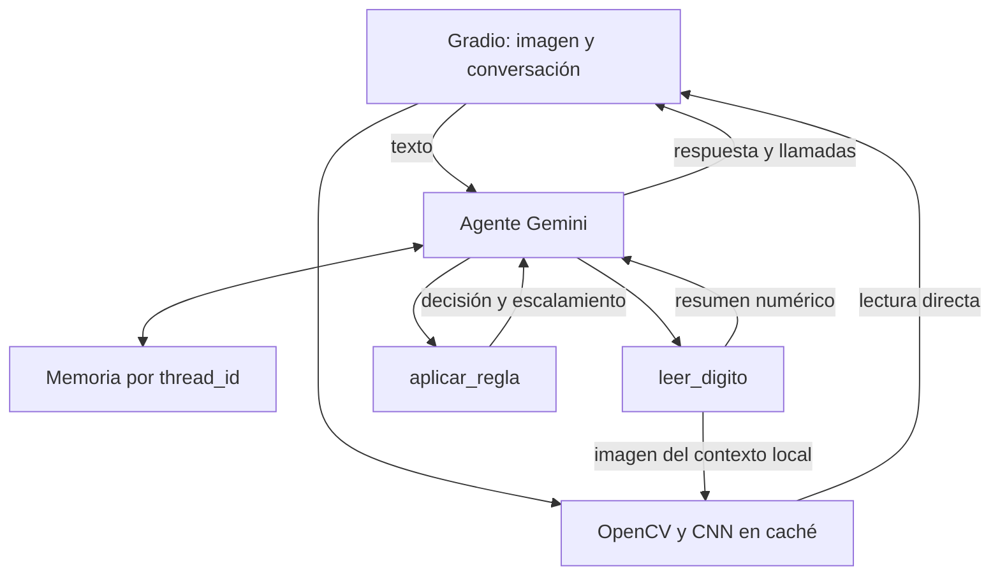
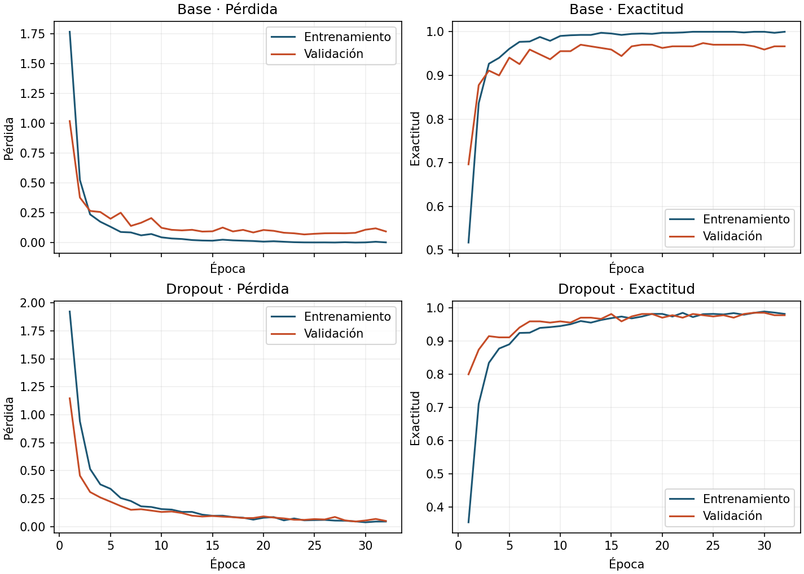
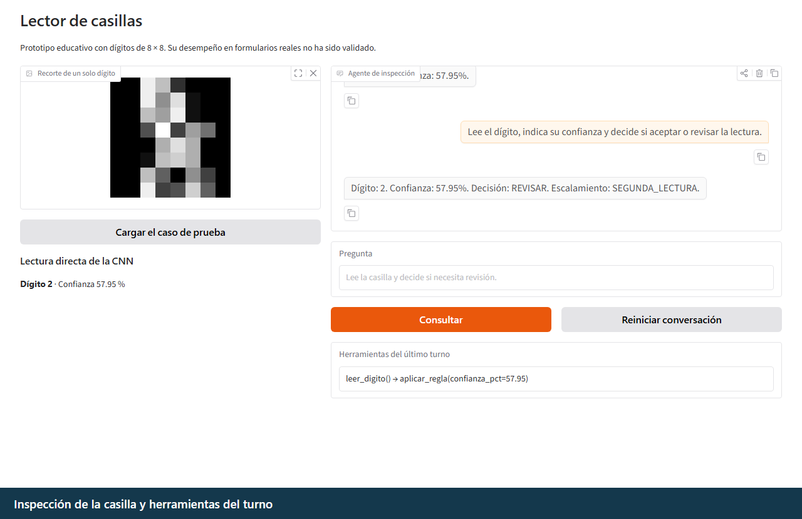

# Lector de casillas manuscritas

Prototipo educativo de **Ruta 1: visión por computador y agente de inspección**.

[Repositorio del equipo en GitHub](https://github.com/paubm21/Saferest360-TallerIA)

## 1. Equipo, ruta y problema

La aplicación recibe una imagen con un solo dígito, muestra la lectura de una CNN y permite preguntar si debe pasar a revisión humana. El experimento utiliza `load_digits`: imágenes de 8 × 8 y diez clases. Es una prueba sobre ese corpus, no una validación de formularios escaneados en condiciones reales.

### Aportes por integrante

Los aportes se presentan según el reparto de responsabilidades del equipo. Cada fila enlaza el producto y la evidencia que sustentan el análisis de ese componente.

| Integrante | Componente a cargo | Aporte al proyecto |
| --- | --- | --- |
| **Wilson Sebastian Moreno Sanchez** | Entrenamiento y evaluación de la CNN | Comparación de las variantes base y con dropout según su pérdida de validación. El análisis de los dos errores de prueba permite estimar cuántas casillas tendría que revisar una persona al aplicar el umbral elegido. [Experimento U4](notebooks/entrenamiento_u4.ipynb) · [Auditoría](assets/auditoria_modelo.json) |
| **Paula Selene Becerra Morales** | Herramientas, memoria y evaluación de Gemini | Distinción entre pedir una lectura y pedir una inspección. La matriz contrasta las herramientas invocadas con la respuesta que recibe el operador y comprueba si el agente recuerda el nombre del lote. [Evaluación final](notebooks/evaluacion_agente_u5.ipynb) |
| **Michael Stevent Chavarro Nope** | Integración local y demostración en Gradio | Recorrido reproducible desde el recorte hasta la decisión de revisión. La interfaz permite comparar la predicción directa con la respuesta del chat y ver qué porcentaje pasó de la CNN a la regla. El video documenta también la memoria y el reinicio. [Interfaz](app.py) · [Demostración](assets/demo-gradio.mp4) |

**Por qué combinar una CNN y un agente.** La CNN resuelve una tarea medible: asigna una clase a la imagen y produce una confianza que se puede contrastar con etiquetas conocidas. El agente interpreta la petición del operador, elige las herramientas y recuerda el nombre del lote dentro de la conversación. La decisión de revisión está implementada en código y puede comprobarse por separado. En el caso 1149, la CNN confunde un 8 con un 2; el agente no descubre la etiqueta correcta, pero debe comunicar la lectura y remitirla a revisión por su confianza de 57,95 %.

Un prompt a un LLM de texto no recibe los píxeles en esta arquitectura. Un LLM multimodal podría ser una alternativa, pero habría que evaluarlo con las mismas imágenes, comparar errores y medir su consumo de API. Su confianza declarada no sustituye automáticamente la salida del clasificador. Tampoco es indispensable usar un agente para aplicar un umbral: una función resuelve esa operación. Aquí el agente aporta la interacción, la selección de herramientas y la memoria; la CNN aporta el modelo entrenado y evaluable.

## 2. Arquitectura del sistema



La imagen permanece en el entorno que ejecuta Gradio. `ToolRuntime` la entrega a la herramienta; Gemini recibe el resumen numérico. La interfaz muestra la CNN antes de consultar al agente y, después de cada turno, muestra las herramientas y sus argumentos. El reinicio elimina el hilo anterior y crea otro.

[Interfaz](app.py) · [Inferencia](src/modelo.py) · [Agente y herramientas](src/agente.py)

## 3. Experimento de la red neuronal y análisis del fallo

### Diseño y elección del modelo

El [notebook U4](notebooks/entrenamiento_u4.ipynb) registra el entrenamiento local de las dos CNN y una auditoría de los pesos recién exportados. Las particiones estratificadas contienen **1.257 / 270 / 270** imágenes de entrenamiento, validación y prueba. La auditoría comprueba que no se solapan y que cubren el dataset.

Las dos CNN comparten semilla **41**, Adam con tasa **0,002**, lotes de **32** y **32 épocas**. Ambas usan convoluciones de 16 y 32 filtros, kernels 3 × 3, una reducción espacial y una capa densa de 48 unidades. Las convoluciones permiten aprender combinaciones de trazos locales; la segunda combina patrones después de reducir la resolución. Se cambia únicamente la tasa de dropout previa a la salida: **0** o **0,35**. Cada variante recupera los pesos de su época de menor pérdida de validación y la elección entre variantes usa esa pérdida, no el conjunto de prueba.

| Variante | Época seleccionada | Pérdida entrenamiento | Pérdida validación | Exactitud entrenamiento | Exactitud validación |
| --- | ---: | ---: | ---: | ---: | ---: |
| Base | 24 | 0,003258 | 0,069753 | 1,000000 | 0,974074 |
| Dropout | 29 | 0,046853 | 0,045646 | 0,984885 | 0,985185 |



En Base, la pérdida de entrenamiento se aproxima a cero y la exactitud llega a 1,0, mientras la validación queda por debajo. Esa separación es compatible con sobreajuste a los datos de entrenamiento. En Dropout, las curvas se mantienen más próximas y la exactitud de entrenamiento no muestra la misma saturación. La comparación tiene un matiz: el dropout está activo durante el entrenamiento y se desactiva al validar, por lo que las dos métricas no se calculan bajo condiciones idénticas.

La exactitud de validación pasa de **0,974074** en Base a **0,985185** en Dropout, sobre las **270** imágenes de validación. La menor pérdida respalda elegir Dropout para esta ejecución, pero una sola semilla no demuestra superioridad general. Un siguiente experimento debería repetir las particiones o semillas y comparar la variabilidad sin usar la prueba para ajustar el modelo. No se ha realizado ese experimento adicional.

### Caso 1149 y auditoría de los pesos

El modelo exportado con dropout acierta **268 de 270** imágenes de prueba (**0,9926**). El índice **1149** tiene etiqueta real **8**, pero la CNN devuelve **2** con **57,95 %**. El PNG y el JSON permiten reproducirlo en la app. [Caso exportado](assets/caso_prueba.json) · [Imagen](assets/caso_prueba.png)

En el recorte, la baja resolución dificulta distinguir los cierres de los bucles del 8 y la continuidad del trazo. Que la CNN lea 2 sugiere una posible ambigüedad de esos rasgos, pero no demuestra qué característica interna causó el error. Para contrastarlo habría que revisar otros 8 confundidos con 2 y variar el recorte o la interpolación de forma controlada. La acción correcta del sistema es solicitar revisión, no afirmar que el dígito real sea 2 ni cambiarlo a 8 sin una referencia humana.

La sección final de U4 imprime los errores completos, el número de lecturas por debajo de 90 % y una comparación de interpolaciones. Se conserva además un [registro de auditoría](assets/auditoria_modelo.json) con el hash de los pesos y las versiones utilizadas. La auditoría se ejecutó después del entrenamiento en este equipo y utilizó los pesos seleccionados por pérdida de validación.

La auditoría local registró dos errores.

| Índice original | Etiqueta real | Predicción | Confianza |
| --- | ---: | ---: | ---: |
| 1149 | 8 | 2 | 57,95 % |
| 1662 | 9 | 5 | 89,55 % |

**11 de las 270 lecturas** quedan bajo 90 %: incluyen los dos errores y nueve
aciertos. En esta prueba, el umbral enviaría ambos errores a revisión, pero también
nueve lecturas correctas. Ese costo operativo impide interpretar toda baja
confianza como un error; tampoco demuestra que en otro conjunto todos los errores
quedarán bajo el umbral.

| Preparación del caso 1149 | Predicción | Confianza |
| --- | ---: | ---: |
| Original de 8 × 8 | 2 | 57,95 % |
| Ampliación a 192 × 192, vecino más cercano | 2 | 57,95 % |
| Ampliación a 256 × 256, vecino más cercano | 2 | 57,95 % |
| Ampliación a 256 × 256, bicúbica | 7 | 39,59 % |

La prueba bicúbica usa Pillow sobre el PNG en escala de grises y después el mismo
preprocesamiento de la app. La lectura pasó a 7 con **39,59 %** en esta ejecución.

**Límite de generalización.** El ejemplo de la app se amplía por vecino más cercano para conservar los bloques de píxeles del recorte original. Una interpolación que suavice el trazo puede cambiar lo que recibe el modelo al reducir nuevamente a 8 × 8. El resultado de prueba mide generalización dentro de `load_digits`, el corpus utilizado en el material de la Unidad 4. No demuestra robustez frente a fotos, inclinación, sombras, líneas de formularios o estilos de escritura externos. Antes de un uso real se necesita un conjunto independiente de formularios y una evaluación del preprocesamiento.

## 4. Agente, herramientas, evaluación y uso de API

`leer_digito` devuelve la clase y la confianza de la CNN. `aplicar_regla` recibe esa confianza en escala **0 a 100**, sin dividirla entre cien, y aplica esta política ilustrativa:

| Confianza | Decisión | Tratamiento |
| --- | --- | --- |
| Menor que 60 % | REVISAR | Dos lecturas humanas independientes y resolución de discrepancias |
| Desde 60 % hasta menos de 90 % | REVISAR | Confirmación o corrección por un operador |
| Desde 90 % | ACEPTAR | Aceptación provisional, sin garantía de acierto |

El escalamiento bajo 60 % agrega una acción de dominio al umbral original de 90 %. Estos cortes son decisiones del prototipo; no se han calibrado con costos ni resultados operativos. La salida softmax tampoco se ha calibrado como probabilidad de acierto. La herramienta no determina la etiqueta verdadera ni ejecuta por sí misma una revisión humana.

Las docstrings especifican qué recibe cada herramienta y qué devuelve. Para inspeccionar una imagen, el agente debe llamar primero a `leer_digito`, transmitir su porcentaje a `aplicar_regla` y responder **«Dígito: N. Confianza: P%. Decisión: REVISAR/ACEPTAR»**. El código no añade esos datos a una respuesta incompleta para hacerla pasar.

### Evaluación de los cuatro turnos

U5 comprueba por separado qué herramientas se invocaron y qué información recibió el operador. Un saludo y una pregunta sobre el nombre del lote pueden resolverse sin consultar la CNN. Una lectura requiere el dígito y su confianza. Si además se pide decidir si aceptar la casilla, la inspección debe pasar ese mismo porcentaje a la regla y comunicar la decisión junto con la lectura. El notebook incluye una prueba de regresión que rechaza una respuesta que solo diga «Decisión: REVISAR». [Casos y comprobaciones de U5](notebooks/evaluacion_agente_u5.ipynb)

<!-- ESTADO_U5_INICIO -->
**Evaluación actual:** COMPLETA. Casos ejecutados con Gemini: **4/4**; trayectorias correctas: **4**; resultados correctos: **4**. Modelo registrado: `gemini-3.5-flash-lite`.

Los cuatro casos cumplen los criterios de esta ejecución. Ver el [notebook actual](notebooks/evaluacion_agente_u5.ipynb) y el [registro de ejecución](assets/evaluacion_actual.json). Las pruebas locales del validador no son respuestas generadas por Gemini.

| Caso | Herramientas observadas | Respuesta real | Cumple |
| --- | --- | --- | --- |
| Saludo | Ninguna | ¡Hola! Bienvenido al lote Aliso. ¿En qué puedo ayudarte hoy? | Sí |
| Lectura | leer_digito | Dígito: 2. Confianza: 57.95% | Sí |
| Inspección | leer_digito → aplicar_regla | Dígito: 2. Confianza: 57.95%. Decisión: REVISAR. Escalamiento: SEGUNDA_LECTURA (Motivo: Confianza baja: dos lecturas humanas independientes; resolver discrepancias.). | Sí |
| Memoria | Ninguna | Me indicaste que tu lote se llama Aliso. | Sí |

<!-- ESTADO_U5_FIN -->

**Alcance del 4/4.** Después de ajustar el prompt a partir de los fallos de Lectura e Inspección, repetimos los mismos cuatro casos, una sola vez cada uno. El 4/4 comprueba que el agente corrigió ambos comportamientos en esa ejecución. Como esas preguntas guiaron los ajustes, harían falta preguntas nuevas para evaluar el resultado de forma independiente y varias ejecuciones por pregunta para medir con qué frecuencia se mantiene. [Historial de las correcciones](#historial-de-las-correcciones)

Una trayectoria correcta no basta: el operador necesita ver el dígito, su confianza y la decisión. La memoria se comprueba preguntando por Aliso en el hilo del saludo; no se supone que otro hilo comparta ese nombre. Al reiniciar, se elimina el estado de esa sesión. El prototipo no implementa memoria persistente entre reinicios del servidor.

### Tokens, cuota y latencia

| Medida implementada | Motivo y alcance |
| --- | --- |
| `max_tokens=1024` | Acota la salida de cada llamada al modelo; una inspección requiere una respuesta breve. No limita los tokens de entrada ni el total de la sesión. |
| `max_retries=1` | Limita los reintentos de la integración ante fallos; evita insistir indefinidamente y aumentar consumo y espera. |
| `recursion_limit=10` | Acota los pasos del grafo por consulta para frenar ciclos. No significa exactamente diez llamadas facturables. |
| `timeout=45` | Limita la espera configurada para una petición; no garantiza que todo el turno termine en ese tiempo. |
| Resumen de la herramienta | Gemini recibe texto con clase, confianza y decisión; los píxeles se procesan localmente. |
| CNN y agente en caché | Evita recargar pesos y reconstruir recursos en cada consulta. No elimina el costo de las llamadas al LLM. |
| Reinicio y caducidad de sesión | Permite liberar el historial. No hay todavía un presupuesto acumulado de tokens o dinero por usuario. |

La interfaz muestra las llamadas del turno, no suma las de toda la conversación. El historial puede crecer y consumir tokens de entrada: los límites anteriores son medidas de contención, no un control completo de cuota.

## 5. Bitácora de Vibe Coding y verificación

Durante el Vibe Coding consultamos a la IA para aclarar conceptos, como la diferencia entre la trayectoria de herramientas y el resultado de un turno. Comprobamos ambos aspectos por separado al comparar las llamadas registradas con la respuesta que recibió el operador. [Evaluación del agente](notebooks/evaluacion_agente_u5.ipynb)

### Interpretación de los resultados

En el caso 1662, la CNN leyó un 5 donde la etiqueta indica un 9. Su confianza fue del 89,55 %. Con la regla del taller, un operador revisaría esa casilla. Si el umbral de aceptación se fijara por debajo de esa confianza, esa misma lectura se aceptaría con el dígito equivocado. Este ejemplo muestra qué se arriesga al reducir la carga de revisión. Para elegir el umbral en un formulario real harían falta ejemplos de ese formulario y una estimación del costo de corregir un dato después de registrarlo. [Errores del conjunto de prueba](notebooks/entrenamiento_u4.ipynb)

El caso 1149 permite evaluar dos partes del sistema con referencias distintas. En U4 se compara el dígito con la etiqueta del conjunto, por lo que la predicción de 2 cuenta como error. En U5 se comprueba si Gemini transmite fielmente la lectura de la CNN y pide la revisión que corresponde a su confianza. La inspección puede, por tanto, cumplir su objetivo aunque el clasificador se haya equivocado. Para corregir el dato hace falta que alguien lea la casilla original. [Caso etiquetado](assets/caso_prueba.json) · [Respuesta de inspección](notebooks/evaluacion_agente_u5.ipynb)

### Historial de las correcciones

| Episodio real | Hallazgo | Cambio y comprobación | Evidencia |
| --- | --- | --- | --- |
| Inspección en la ejecución anterior | El agente llamó a `leer_digito` y pasó 57,95 a `aplicar_regla`. Al operador solo le llegó «Decisión: REVISAR». Las cuatro trayectorias fueron correctas y tres respuestas cumplieron el criterio. | Al observar la omisión, ajustamos el prompt para exigir dígito, confianza y decisión en la respuesta de inspección. En la primera evaluación local ya aparecieron los tres datos. | [Notebook anterior con la respuesta original](assets/evaluacion_agente_u5_antes.ipynb) · [Primera evaluación local](assets/primera_evaluacion_local.json) |
| Lectura en la primera evaluación local | Al pedir solo el dígito y su confianza, el agente llamó también a `aplicar_regla`. Las cuatro respuestas cumplieron el criterio de contenido y solo tres turnos usaron las herramientas esperadas. | Ajustamos el prompt para terminar la lectura después de `leer_digito` cuando el operador solo pide esos dos datos. En la repetición final, Lectura usó una herramienta e Inspección conservó las dos. | [Traza con la llamada adicional](assets/primera_evaluacion_local.json) · [Prompt corregido](src/agente.py) · [Trazas finales](assets/evaluacion_actual.json) |
| Evaluación que podía terminar sin aprobar los casos | El bucle original imprimía el fallo o se interrumpía sin exigir que los cuatro casos cumplieran. | U5 exporta estado, casos y resultados; con clave exige completitud, trayectorias, argumentos y respuestas correctas. El ejecutor conserva las salidas también cuando una aserción falla. | [U5](notebooks/evaluacion_agente_u5.ipynb), [ejecutor](src/ejecutar.py) |
| Afirmaciones sin salida verificable | El segundo error y la sensibilidad al reescalado no figuraban en las salidas originales. | Se añadió y ejecutó una auditoría con pesos originales, particiones disjuntas, errores e interpolaciones. Se documenta el límite de dominio en la app. | [Auditoría](src/auditoria.py), [U4](notebooks/entrenamiento_u4.ipynb), [registro](assets/auditoria_modelo.json) |

## 6. Demostración en Gradio

[Ver la demostración local de 46 segundos](assets/demo-gradio.mp4). El video reúne capturas consecutivas de una sesión real de la app en Windows con Gemini. Muestra el saludo, la lectura del caso 1149, la inspección, el recuerdo de «Aliso» y el reinicio. En el turno de inspección se observa el argumento de la segunda herramienta y la decisión de remitir la casilla a una segunda lectura humana.



También pueden consultarse la [lectura directa](assets/demo-cnn.png), la [prueba de memoria](assets/demo-memoria.png) y el [reinicio](assets/demo-reinicio.png).

## 7. Instalación y ejecución local

Se necesitan Git y Python 3.12. El repositorio incluye los pesos entrenados. Para probar la aplicación desde una copia nueva, ejecuta en una terminal de Linux o macOS:

```bash
git clone https://github.com/paubm21/Saferest360-TallerIA
cd Saferest360-TallerIA
python3.12 -m venv .venv
source .venv/bin/activate
pip install -r requirements.txt
cp .env.example .env
```

Abre `.env` en un editor y escribe tu clave de Gemini después de `GOOGLE_API_KEY=`. Guarda el archivo. La lectura directa de la CNN se ejecuta localmente. El chat necesita la clave y conexión a Internet. Desde la misma terminal, inicia Gradio:

```bash
python app.py
```

Abre [la aplicación en tu navegador](http://127.0.0.1:7860), pulsa **Cargar el caso de prueba** y pregunta «Lee el dígito, indica su confianza y decide si aceptar o revisar la lectura». Puedes detener el servidor con Ctrl+C.

### Alternativa para Windows

Con Git y Python 3.12 instalados, abre PowerShell y ejecuta:

```powershell
git clone https://github.com/paubm21/Saferest360-TallerIA
cd Saferest360-TallerIA
.\taller.cmd preparar
```

El comando prepara el entorno, instala los paquetes de `requirements.txt` y crea `.env` a partir de la plantilla. Guarda tu clave en `.env` y ejecuta `.\taller.cmd app`.

### Reproducir los resultados

Ejecuta estos comandos desde la raíz del proyecto con el entorno virtual activo. En Windows también puedes usar los comandos de la última columna.

| Acción | Python | Alternativa en PowerShell |
| --- | --- | --- |
| Entrenar ambas CNN, exportar los pesos y guardar la auditoría de U4 | `python -m src.ejecutar_en_proceso entrenamiento_u4` | `.\taller.cmd entrenar` |
| Evaluar los cuatro casos con Gemini y reflejar el resultado en el README | `python -m src.ejecutar_en_proceso evaluacion_agente_u5` y después `python -m src.actualizar_readme` | `.\taller.cmd evaluar` |
| Ejecutar las pruebas de regresión | `python -m unittest discover -s tests -v` | `.\taller.cmd pruebas` |

Los cuadernos guardan sus salidas en `notebooks/`. Las curvas, la auditoría del modelo y el registro de evaluación del agente quedan en `assets/`.
